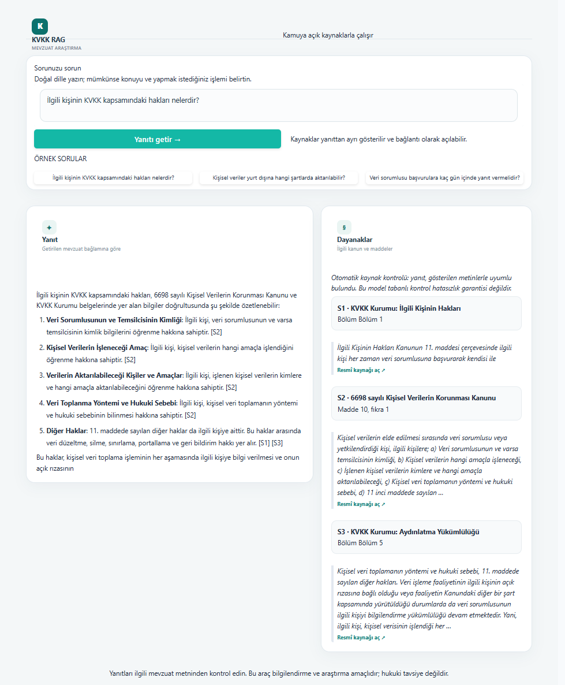

# kvkk-rag-tr

Türkçe KVKK ve ilişkili mevzuat metinlerinde kaynak gösteren soru-cevap için modüler bir Retrieval-Augmented Generation (RAG) çalışma alanı. Proje, yalnız demo üretmeyi değil; Türkçe mevzuat aramasında veri bölümleme, embedding, BM25/hibrit retrieval ve reranking seçeneklerini aynı değerlendirme setinde ölçmeyi hedefler.

> **Hukuki uyarı:** Bu araç hukuki tavsiye değildir. Yanıtlar yalnız getirilen kamuya açık kaynak bağlamından üretilir; mevzuat güncelliği ve hukuki yorum için resmî kaynakları ve uzman görüşünü kontrol edin. Sisteme özel/kişisel veri göndermeyin.

## Proje durumu

- Kaynak manifestinde 4 mevzuat metnine ek olarak KVKK Kurumunun 7 resmî konu sayfası listelenir. Yeni sayfalar yerel corpus ve indeks yeniden üretildiğinde aramaya katılır; kaynak adresleri `configs/sources.json` içindedir.
- Sabit boyut, madde bazlı ve embedding benzerliğine dayanan chunking stratejileri config'ten seçilebilir.
- Embedding seçenekleri `intfloat/multilingual-e5-base` ve `BAAI/bge-m3`; retrieval seçenekleri vektör, BM25 ve RRF hibrittir. CrossEncoder reranking isteğe bağlıdır.
- Varsayılan RAG ayarı vektör ve BM25 sıralamalarını RRF ile birleştirir. Yanıt üretildikten sonra kullanılan atıf etiketleri süzülür ve etkin ayarda aynı LLM, iddiaları gösterilen mevzuat parçalarına göre ikinci kez denetler.
- [82 soruluk değerlendirme seti](eval/questions/kvkk_seed.jsonl) henüz `draft`; hiçbir gold etiket uzman doğrulamasından geçmedi.
- Retrieval pilotu aynı 82 taslak soruda çalıştırıldı; sonuçlar yalnızca keşif amaçlıdır.

Gecikme ve yeniden indeksleme ayarları config dosyalarında bulunur. `/ask` yanıtı `latency_ms` alanında API süresini bildirir.

Yanıt inceleme şablonu `eval/answer_review_template.csv` içindedir; taslak deneyler kalite sonucu sayılmaz.

## Mimari

```mermaid
flowchart LR
    A[Resmî kamu mevzuat kaynakları] --> B[Ingestion ve temizleme]
    B --> C[Madde/fıkra JSONL corpus]
    C --> D{Chunking config}
    D --> D1[Sabit boyut]
    D --> D2[Madde/başlık]
    D --> D3[Semantik]
    D1 --> E[Chunk kayıtları]
    D2 --> E
    D3 --> E
    E --> F[Embedding modelleri]
    E --> G[BM25 JSONL indeksi]
    F --> H[Chroma vektör indeksi]
    G --> I{Retriever}
    H --> I
    I --> I1[Vektör]
    I --> I2[BM25]
    I --> I3[RRF hibrit]
    I1 --> J[İsteğe bağlı CrossEncoder]
    I2 --> J
    I3 --> J
    J --> K[Bağlamla sınırlı üretim]
    K --> L[Ollama veya OpenAI uyumlu API]
    L --> M[Atıf etiketlerini süz]
    M --> N[LLM kaynak destek denetimi]
    N --> O[FastAPI /ask]
    O --> P[Gradio UI]
    I --> Q["Recall at k; MRR; nDCG"]
    K --> R[Atıf kapsama heuristic'i]
    N --> S[Kaynak destek denetimi]
    Q --> T[CSV / JSON deney sonuçları]
    R --> T
    S --> T
```



Varsayılan akış hibrit aramadır. Yanıtta kullanılan etiketler kaynak listesine eşlenir; etkin kaynak denetimi, iddiaları aynı kaynak metinlerine karşı ikinci bir LLM çağrısıyla kontrol eder ve denetim geçmezse kaynak kartlarını göstermeyip yanıt vermekten kaçınır.

## Kurulum ve yerel çalıştırma

Python 3.11 veya üstü gerekir. Aşağıdaki beş PowerShell komutu temel kurulum ve indekslemeyi yapar:

```powershell
python -m pip install -e ".[retrieval,web,dev]"
Copy-Item .env.example .env
python -m src.ingestion.cli
python -m src.retrieval.index_cli --config configs/rag.json
python -m src.generation.cli "İlgili kişinin hakları nelerdir?" --config configs/rag.json
```

İlk ingestion resmî kaynaklardan indirme yapar; ağa çıkmadan daha önce indirilmiş ham dosyaları yeniden işlemek için `--offline` kullanın. İlk embedding çalıştırması model ağırlıklarını Hugging Face'den indirir. Varsayılan üretici Ollama'dır (`configs/generation.json`); modelin Ollama'da kurulu ve servisinin çalışır olması gerekir. OpenAI uyumlu sağlayıcıya geçerken config'teki provider/base URL'yi güncelleyin ve gerçek anahtarı `.env` içindeki `OPENAI_API_KEY` alanına koyun. `.env` ve yerel veri/indeks dosyaları Git dışında tutulur.

Varsayılan yerel LLM `qwen3:8b` modelidir. Ollama uygulamasını çalıştırın ve modeli bir kez indirin:

```powershell
ollama pull qwen3:8b
ollama list
```

`ollama list` çıktısında `qwen3:8b` görünmeli; Windows'ta Ollama uygulaması açıkken servis arka planda çalışır.

### API ve arayüz

İki terminal açıp API ile Gradio'yu çalıştırın:

```powershell
uvicorn src.api.app:app --reload --port 8001
python -m src.ui.app
```

API dokümantasyonu `http://127.0.0.1:8001/docs`, arayüz `http://127.0.0.1:7861` adresindedir. `/ask` endpoint'i `{"question":"..."}` alır; cevap, atıf etiketi, madde, kısa kaynak alıntısı, URL ve `verification_status` alanlarını JSON olarak döndürür. `KVKK_RAG_CONFIG` alternatif RAG config'i, `KVKK_API_URL` UI'ın bağlanacağı endpoint'i seçer.

### Docker Compose

Ön koşullar: Docker Engine ve Docker Compose v2; varsayılan config ile host üzerinde çalışan Ollama.

```powershell
Copy-Item .env.example .env
docker compose build
docker compose run --rm api python -m src.ingestion.cli
docker compose run --rm api python -m src.retrieval.index_cli --config configs/rag.json
docker compose up
```

Compose API'yi `http://localhost:8001`, Gradio'yu `http://localhost:7861` adresinde sunar. Host Ollama adresi `docker-compose.yml` içindeki `OLLAMA_BASE_URL` ile ayarlanır. Model indirmeleri Docker named volume içinde, mevzuat corpus'u ve indeksler yerel `data/` bind mount'unda tutulur. `.env` build context'e kopyalanmaz; Compose, OpenAI API anahtarını API container'ına ortam değişkeni olarak aktarır.

## Deneyler ve ölçüm

Pilot configler `draft` setini açıkça seçerek keşifsel koşu yapar. Standart eval configleri varsayılan olarak yalnız `validated` soruları alır; uzman incelemesi tamamlanmadan bu configlerde sonuç üretilmez.

```powershell
python -m eval.run --config configs/eval-pilot-hybrid.json
python -m eval.compare --results-dir results/preliminary --output-dir results/preliminary/comparison
```

Runner soru bazında ve makro ortalama olarak Recall@k, MRR@k ve nDCG@k üretir. `run_generation` açıldığında atıf kapsama heuristic'i ve kaynak destek denetimi durumu da kaydedilir. Atıf kapsama, bir iddiada geçerli etiket bulunup bulunmadığını ölçer; metnin anlam desteğini ölçen sonuç `verification_status` alanıdır ve aynı LLM'in ikinci geçişine dayanır. JSON metadata'sında soru seti, corpus ve config hash'leri bulunur; çıktıların hepsi `results/` altında üretilir. Karşılaştırma script'i mevcut deney JSON'larından CSV, Markdown ve SVG üretir; ölçüm uydurmaz.

### Deney sonuç tablosu

Aşağıdaki **pilot** retrieval ölçümleri gerçek `eval.run` çalıştırmalarından üretildi. Aynı 82 soruluk set kullanıldı; tümü `draft` olduğundan sonuçlar kalite iddiası değil, etiketleri doğrulanmamış keşifsel baseline'dır. Yalnızca retrieval ölçüldü; cevap kalitesi ve reranker henüz ölçülmedi.

| Pilot deney | Retrieval | Soru | Recall@5 | MRR@5 | nDCG@5 |
| --- | --- | ---: | ---: | ---: | ---: |
| BM25 | BM25 | 82 draft | 0.6463 | 0.4293 | 0.4827 |
| Hibrit RRF | RRF hibrit | 82 draft | 0.7602 | 0.5417 | 0.5941 |
| Vektör | multilingual-e5-base | 82 draft | 0.6748 | 0.4911 | 0.5328 |

Makine tarafında üretilen sonuçlar `results/preliminary/`, karşılaştırma Markdown/CSV/SVG'si ise `results/preliminary/comparison/` altındadır. JSON metadata'sı korpus, config ve soru dosyasının SHA-256 özetlerini ve `preliminary_unreviewed` geçerlilik etiketini içerir. Uzman onaylı gold etiketleri oluşturulunca aynı deneyler `validated` setle yeniden çalıştırılmalıdır.

Embedding modelini karşılaştırmak için aynı retrieval ayarıyla `configs/rag-bge-m3.json` kullanan eval config'i oluşturun. Chunking stratejisi `configs/chunking.json` içinde belirlenir; her değişiklikten sonra vektör ve BM25 indekslerini yeniden üretin. Konfigürasyonlar arası adil karşılaştırma için aynı doğrulanmış soru setini, gold maddeleri ve `k` değerlerini kullanın.

### Demo görüntüsü




## Türkçe'de arama neden zor?

Türkçe sondan eklemeli bir dildir: tek bir kök, hâl ve iyelik ekleriyle çok sayıda yüzey biçimine dönüşebilir. Örneğin “veri”, “verilerin”, “verilerimizden” biçimleri aynı kavrama işaret ederken BM25'in yüzey-token eşleşmesini zayıflatabilir. Türkçe büyük/küçük `I/İ` dönüşümü ve mevzuattaki uzun, iç içe koşullu cümleler de normalizasyon, chunk sınırları ve sorgu-belge eşleşmesini etkiler. Projedeki BM25 tokenizer'ı Türkçe `I/İ` dönüşümünü korur; stemming/lemmatization şu an etkin değildir ve etkisi ölçülmüş değildir.

## Sınırlılıklar ve gelecek işler

- Kaynak manifesti 4 resmî mevzuat metni ve 7 KVKK Kurumu konu sayfası içerir; yerel korpus ve indeks bunlar yeniden indirildiğinde oluşur.
- Soru setindeki 82 örneğin hepsi `draft`; hukuki uzman incelemesi ve gold madde doğrulaması gerekir.
- multilingual-e5-base, BM25 ve hibrit retrieval için 82 taslak soruda keşifsel pilot alındı; reranker ve LLM cevap metriği henüz alınmadı.
- Kaynak destek denetimi üreticiyle aynı LLM'i kullanır; bağımsız bir doğrulama değildir ve yanlış kabul/ret kararı verebilir. Otomatik kontrolden geçmesi doğruluk garantisi oluşturmaz; resmi mevzuat metni ve insan incelemesi gerekir.
- Zemberek veya başka morfolojik analiz eklenmedi; mevcut lexical baseline yalnız Unicode tokenizasyonu ve Türkçe `I/İ` normalizasyonu kullanır.
- Sonraki çalışmalar: soru setini uzmanla doğrulama, karar/rehber kaynaklarını lisans ve erişim koşullarını kontrol ederek ekleme, tüm chunking/embedding kombinasyonlarını deney config'leriyle çalıştırma, morfolojik ön işlemeyi ölçme ve hata analizinden sonra retrieval/prompt iyileştirme.

## Geliştirme ve test

```powershell
python -m pip install -e ".[dev,web]"
python -m pytest -q
ruff check src eval tests
ruff format --check src eval tests
```

GitHub Actions her push ve pull request'te pytest ile Ruff lint kontrolünü çalıştırır. Önerilen commit formatı Conventional Commits'tir; örneğin `feat(eval): add hybrid retrieval benchmark runner`.

## Lisans ve veri kullanımı

Bu depoda yalnız kamuya açık resmî mevzuat kaynaklarına yönelik ingest kodu ve kaynak manifesti bulunur. İndirilen corpus ve indeksler yerel ortamda üretilir; kaynak sayfalarının kullanım koşulları ve değişiklikleri için resmî yayıncıları kontrol edin. Projeye kişisel veri veya izinsiz/telifli içerik eklemeyin.
